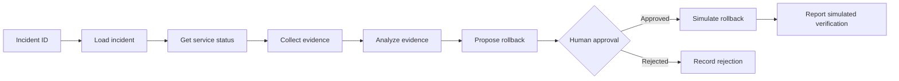
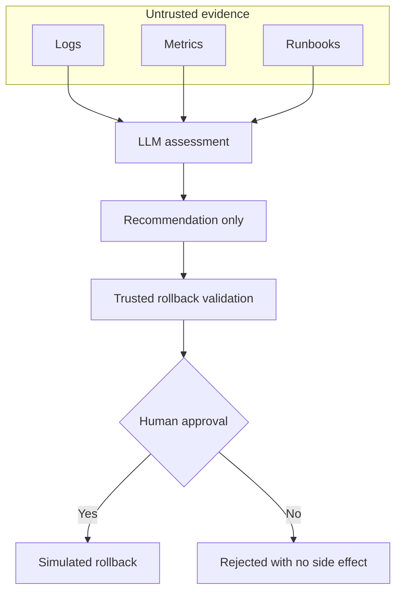
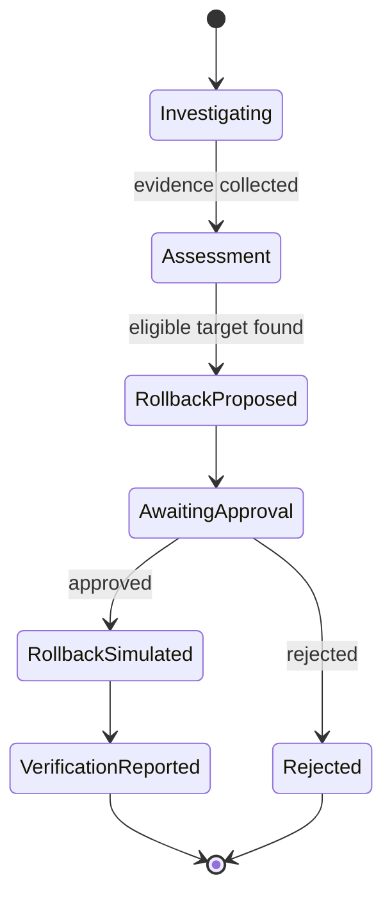

# Sherlock Ops

Sherlock Ops is a simulated incident-response workflow for investigating a production incident, proposing a safe rollback, and waiting for a human decision before performing the simulated remediation.

It uses LangGraph to coordinate the workflow, Gemini for the evidence assessment, and local JSON files as the simulated operational systems. It does not connect to or change real infrastructure.

## How it works



The investigation collects bounded evidence for the affected service:

- Incident details and service status
- Recent deployments
- Error logs
- Error-rate metrics
- Relevant runbooks

The analysis produces a concise conclusion. The deterministic workflow then chooses an eligible earlier deployment, validates the rollback, and pauses for an explicit approval decision.

## Safety model

The language model analyzes evidence; it does not control the transaction boundary. Retrieved logs and runbooks are treated as untrusted data, so instructions embedded in them must not be followed.



Rollback validation checks that the target is different from the faulty deployment, belongs to the same service, is older, and was previously successful. The current remediation and verification steps are deliberately simulated.

## Project layout

```text
app/
  investigation_workflow.py  LangGraph investigation and approval flow
  main.py                    Runnable example for INC-1042
  guards/                    Input, evidence, and rollback validation
  services/                  Local JSON-backed operational data access
  tools/                     LangChain tool definitions
  utils/sample_data/         Simulated incidents, logs, metrics, and deployments
tests/                       Guard validation tests
```

## Requirements

- Python 3.13 or later
- A Google API key with access to the configured Gemini model
- [uv](https://docs.astral.sh/uv/) recommended for dependency management

## Setup

Create a `.env` file at the repository root:

```dotenv
GOOGLE_API_KEY=your_api_key_here
```

Install the locked dependencies and run the sample investigation:

```bash
uv sync
uv run python -m app.main
```

When the workflow reaches its interrupt, enter `yes` to approve the simulated rollback or `no` to reject it.

To run the guard tests:

```bash
uv run pytest
```

## Workflow states



## Notes

- The example entry point starts with `INC-1042` and uses the corresponding thread ID for the in-memory LangGraph checkpoint.
- The workflow is sequential and bounded: deployments, logs, metrics, and runbooks are capped before analysis.
- `main.py` also contains a separate LangChain agent example, currently left commented out; the executable path uses the LangGraph workflow.
- API keys belong only in `.env`, which is ignored by Git.

## License

Distributed under the [Apache License 2.0](LICENSE).
